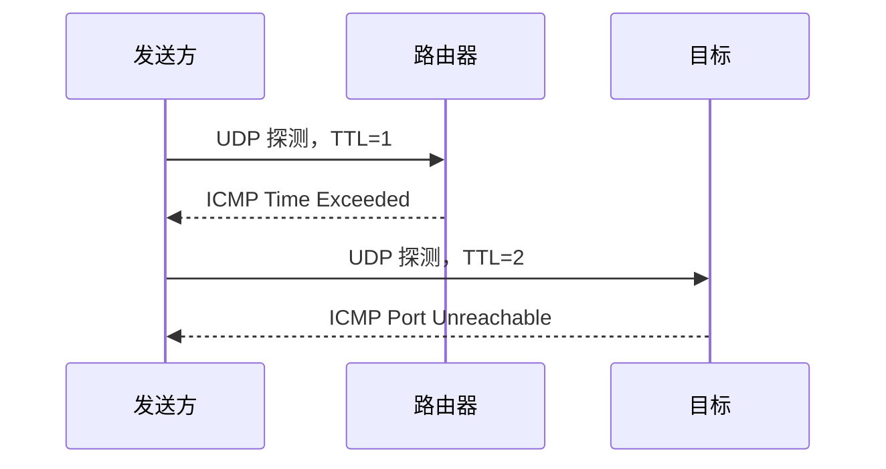

# 配图

学生卡住的地方通常是“谁先发、谁回、包从哪走”，而这些用一段文字很难读。这类内容默认配一张图，不要只写文字。

## 1. 默认要画

出现下面任一情况，先画图再解释：

- 讲一次交互：握手、探测与回包、请求与响应、超时与重传；
- 讲一条路径：包从哪出发、经过谁、到哪结束；
- 讲状态怎么变：TCP 连接状态、拥塞窗口的阶段；
- 讲分层与封装：数据在哪一层加了什么首部；
- 同一个机制学生连续两次没接住——换一张图重讲，不要重复同一段文字。

判断口诀：如果你正在写“先……然后……再……”，或者“从 A 经过 B 到 C”，就画一张。

## 2. 不要画

- 首部字段、字节布局 → Markdown 表格；
- 数值随时间的变化（cwnd、窗口） → 表格，Mermaid 画折线又难写又容易错；
- 一句话能说清的关系；
- 同一张图前面已经画过 → 用文字指回“还是刚才那张图”。

## 3. 选型

| 要表达 | 用什么 |
|---|---|
| 拓扑、路径、转发、分层封装 | `flowchart LR`（左右）或 `flowchart TB`（上下） |
| 一问一答、握手、TTL 递减、重传 | `sequenceDiagram` |
| TCP 状态迁移 | `stateDiagram-v2` |
| 字段、首部、取值 | Markdown 表格，不要用图 |

## 4. 硬约束

前端的 Mermaid 配置是固定的：`securityLevel: strict`、`htmlLabels: false`、主题 `default`。所以：

- 语言标记只能写 `mermaid`，小写，不加空格；
- 标签里有中文标点（，。：；（）/）或空格时，一律用双引号包住：`A["TTL 减到 0，丢弃"]`；
- 不在标签里用 HTML，` `、`<b>` 都不会生效；
- 不写 `%%{init}%%`、`classDef`、颜色和样式，会被前端主题覆盖或直接报错；
- 不用 `click`、外链和脚本；
- 节点控制在 8 个以内，每条消息不超过 40 字；图会被缩放到容器宽度，节点越多字越小；
- 一张图只表达一件事，不要在一张图里塞完整章。

## 5. 图和文字一起给

前端解析失败时会直接把源码显示给学生，所以每张图都要能脱离图读懂：

- 图前一句：这张图要看什么（“注意第二条链路没有回包”）；
- 图后一句：结论，或一个让学生预测的问题；
- 不复述图里已经写明的内容。

## 6. 例子

好：一次探测的超时与回包

好：路径与分叉

坏：

- 把第 5 章的所有协议塞进一张 `flowchart`；
- 用 `sequenceDiagram` 画首部字段布局；
- 节点全是 `A1`、`A2`、`A3`，正文还要逐个解释编号；
- 只有图，一句说明都没有。
