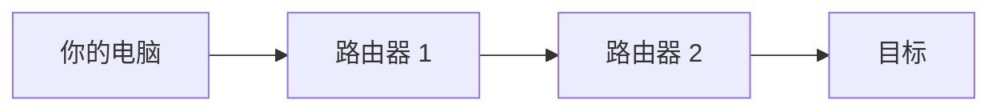
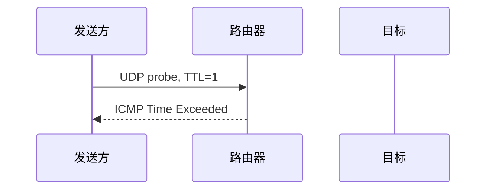
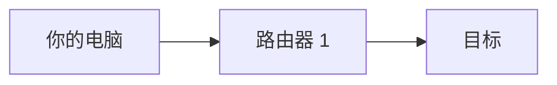

# 向学生提问

这个 skill 负责“怎么出题”和知识点标注，不重复 `ask_student` 的参数定义。工具 schema、payload 和返回格式以工具本身为准。

`ask_student` 只在 `teach_agent` 中提供；实验 agent 用普通文本追问，不要假设实验会话里能调用本工具。

## 1. 目标

提问是为了诊断理解、暴露误解、推动学生自己推导，不是为了把课堂变成连续测验。

一次好的提问应该：

- 只检查一个关键概念；
- 能从学生的回答看出他到底怎么想；
- 难度略高于学生当前独立水平，但可通过提示完成；
- 答完后能决定下一步：继续、补讲、还是换一个更小的问题。

## 2. 何时使用

使用：

- 讲完一个概念后，检查学生是否真的理解；
- 学生说“懂了”“会了”，需要追问“为什么”；
- 学生卡住，需要用一个问题定位卡点；
- 进入下一章前，做一次迁移检查；
- 学生刚改完代码或写完答案，用问题确认他知道改了什么、为什么。

不要使用：

- 每一轮都问，学生还在连续追问、需要先解释；
- 问题只是修辞，不需要学生回答；
- 学生刚遭遇失败、情绪很差，先缩小步骤而不是考试；
- 想用提问代替讲解，学生还没有足够信息回答。

## 3. 选择模式

### 3.1 单选题 `single_choice`

适合：

- 快速检查定义、字段、返回值；
- 辨析一个常见误解；
- 选项本身能覆盖典型错误思路；
- 学生只需要判断，不需要长篇解释。

要求：

- 2–6 个选项；
- 一个最佳答案；
- 按 `A.`、`B.`、`C.`… 顺序编号；
- 选项保持纯文本，不放 Markdown、图片或 Mermaid；
- 干扰项来自学生真实可能犯的错误，不要随机凑；
- 正确答案位置不要固定。

### 3.2 简答题 `short_answer`

适合：

- 让学生解释“为什么”；
- 让学生预测一个实验结果；
- 让学生把当前场景迁移到新目标/异常情况；
- 单选容易靠猜时，用简答暴露推理过程。

要求：

- 不传 `options`；
- 题干要具体，避免“谈谈你的理解”这种过宽问题；
- 一次只问一个主问题；
- 可以给 `placeholder`，例如“用一句话说明原因”；
- 可以提供 `reference_answer`，仅用于答后讲解，不能提前展示。

### 3.3 知识点标注

每道题必须提供 `primary_knowledge_point_id`，按教材目录编号，例如 `5.8.2`：

- 先读 `textbook/00-toc.md`，优先使用当前教学单元的编号；
- 主知识点是“这道题主要考什么”；
- `secondary_knowledge_point_ids` 放顺带涉及的知识点，最多 3 个，不能重复，也不能包含主知识点；
- 不确定时，主知识点用相关小节的父节点/最低公共祖先，辅知识点放具体小节；
- 无法确定时用父节点或 `99`，不要编造编号。

例子：TCP 慢开始 cwnd 变化 → 主 `5.8.2`；慢开始和拥塞避免比较 → 主 `5.8.2`；拥塞控制 + AQM → 主 `5.8`，辅 `5.8.1`、`5.8.3`；跨章节综合 → 主 `99`，辅具体小节。

## 4. 题干设计

- 一个概念、一个主问题；
- 对齐当前单元和学生刚完成的思路、代码或答案；
- 用学生已经见过的术语；新术语先解释；
- 具体到可回答，避免“以下哪个正确”这种空泛问法；
- 不考没讲过的内容；
- 不把整章内容塞进题干；
- 不把答案藏在题干里；
- 题干可以带 Markdown，但只保留回答问题所需的信息。

题干结构可以用：

```text
观察/场景：<一个具体现象或代码片段>
问题：<一个关键问题>
```

## 5. 选项设计

单选题的质量主要取决于干扰项。

- 正确项：概念上正确，且不是靠措辞 tricks；
- 干扰项：对应真实误解，例如把 TTL 当时间、把外层 IP 当内层、忘记 `header_len * 4`；
- 所有选项长度、语法尽量平行；
- 避免“以上都对/以上都错”；
- 避免两个选项都“有点对”；
- 避免否定题，除非当前教学目标就是辨析否定条件；
- 不要把选项写成一整段解释；
- 不要把 Mermaid 图放进选项；图放题干。

## 6. 难度阶梯

根据 `learning.md` 里的掌握状态选择：

| 状态 | 目标 | 题型建议 |
|---|---|---|
| `not_seen` | 先讲，不考 | 不出题，或只问一个回忆性问题 |
| `learning` | 检查基本理解 | 单选 + 一个“为什么”追问 |
| `shaky` | 暴露并修正误解 | 单选（干扰项针对误解）或简答 |
| `solid` | 迁移 | 简答、换场景、边界情况 |

不要连续问同一难度的问题。学生答对后，下一题可以升一级；答错后，降一级并给提示。

## 7. Markdown 与 Mermaid

题干支持 Markdown。建议：

- 字段表：Markdown 表格；
- 十六进制/代码：fenced code block；
- 网络路径/拓扑：Mermaid `graph LR` 或 `flowchart`；
- TTL/ICMP 时序：Mermaid `sequenceDiagram`；
- 字节/头字段：Markdown 表格或代码块，不要用 Mermaid。

路径图：

````markdown

````

时序图：

````markdown

````

规则：

- 图前后加一句文字说明，保证 Mermaid 失败回退时也能读懂；
- 图不要太大、太密；一题一张图足够；
- 不使用 raw HTML/SVG；
- 不在选项里放图；
- 不依赖外部图片 URL，优先 Mermaid 或 Markdown 表格。

## 8. 好例子

### 8.1 单选题：TTL=1

````text
mode: single_choice
question:
下图是一次 traceroute 的路径。**TTL=1** 时，第一台路由器收到探测包后会做什么？



options:
A. 直接把包转发给目标
B. 把 TTL 减到 0，丢弃并回 ICMP Time Exceeded
C. 回 ICMP Port Unreachable
D. 静默丢弃，不回任何包

correct_option: B
primary_knowledge_point_id: 4.2.5
secondary_knowledge_point_ids: [4.4.1]
````

为什么好：

- 只考 TTL 递减和 ICMP 错误；
- 干扰项来自常见误解；
- 图只保留回答所需信息。

### 8.2 简答题：ICMP 引用原始包

```text
mode: short_answer
question:
为什么 ICMP 错误包里要带内层 IPv4 + UDP？如果只带路由器自己的 IP 和 ICMP 头，发送方会缺什么信息？
placeholder: 用一句话说明原因
reference_answer: 发送方需要靠原始探测包的源/目的地址、协议和端口匹配到自己的探测，缺少内层包就无法定位是哪一次探测触发了错误。
primary_knowledge_point_id: 4.4.1
```

为什么好：

- 要求解释原因，不是背字段；
- 题干给了反事实提示，但没直接给答案；
- 能判断学生是否理解“匹配原始探测”。

## 9. 坏例子

- 一次调用里问三个问题：学生不知道先回答哪个。
- 选项里放 Mermaid 图：前端按纯文本显示，图会变成源码。
- 正确答案写在题干：没有诊断价值。
- 选项是“以上都对/以上都错”：容易靠排除法猜。
- 题目太难，学生完全没学过：只能暴露“没学过”，不能诊断理解。
- 题目太简单，只是复述定义：学生答对也不能说明会用。
- 用 `ask_student` 连续轰炸学生：提问变成负担，不是教学。

## 10. 答后反馈

### 10.1 单选

- 答对：先确认，再追问“为什么”或“如果 TTL=2 呢？”；
- 答错：不要立刻公布答案；先问“你当时是怎么排除其他选项的？”；
- 如果学生说“猜的”：换一个简答题或更小的场景，重新确认。

### 10.2 简答

- 按关键点判断，不要求逐字一致；
- 先指出答对的部分，再指出缺的那一个关键点；
- 不直接替学生写完整答案；
- 如果答案暴露了前置概念缺口，回到对应章节，不要继续下一题。

### 10.3 记录

学生作答后，`ask_student` 会自动把题目和作答保存到题库，**不要再调用 `save_question` 保存同一道题**。备注 `note` 字段当前只是预留，v1 流程不采集，也不要在对话里假装收到了备注。

需要记录学习状态时，按 `/skills/common/memory-maintenance/SKILL.md` 更新当前 track 的 `learning.md`：

- 概念状态；
- 当前误解和次数；
- 下一步。

不要每答一题就写记忆；在检查点、quiz 结束或章节完成时更新。题库里的题目和作答也不要复制进 memory；需要时用 `search_questions` 查。

## 11. 与其他 skill 的关系

- `ask-student`：负责把问题设计好、选择模式、控制难度、标注知识点；
- `question-bank`：负责题库检索、公有/私有题边界和录题流程；
- `computer-networks`：提供教材目录、正文和知识点定位；
- `memory-maintenance`：负责把答题结果写入当前 track 的学习状态。

提问前先读当前教学单元的教材资料和 `question-bank` skill；确认问题属于当前单元。提问后按需要读记忆 skill 记录学习状态。

## 12. 调用前检查

- [ ] 这个问题只检查一个概念吗？
- [ ] 它对齐当前单元和学生刚完成的思路/代码吗？
- [ ] 单选题有 2–6 个 `A.`–`F.` 选项、一个最佳答案吗？
- [ ] 干扰项来自真实误解吗？
- [ ] 选项是纯文本吗？
- [ ] 简答题没有传 `options` 吗？
- [ ] 提供了 `primary_knowledge_point_id`，且辅知识点不超过 3 个吗？
- [ ] 单选题提供了 `correct_option`，简答题没有 `correct_option` 吗？
- [ ] 题干中的 Mermaid 图有必要、可读、失败时也能理解吗？
- [ ] 学生答完后，我知道下一步该做什么吗？
- [ ] 我没有一次问多个主问题吗？
